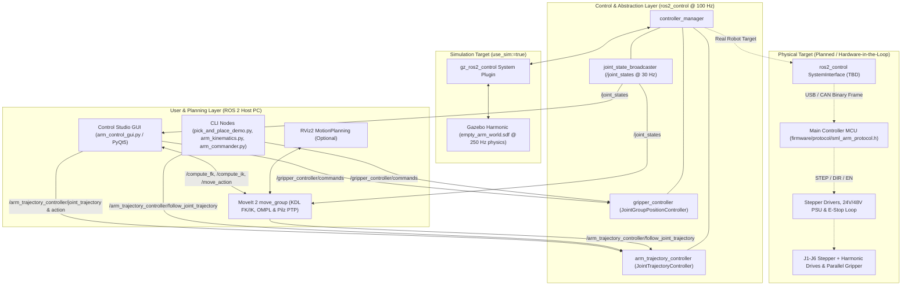

# SML-Arm System Architecture

**SML-Arm** is a full-stack open-source 6-DOF articulated robotic manipulator designed around modular mechanical hardware (`J1`–`J6` stepper motors + harmonic drives and a parallel 2-finger gripper), deterministic embedded control, and a **ROS 2 Jazzy + Gazebo Harmonic + `ros2_control` + MoveIt 2** software stack.

---

## End-to-End Stack Overview

---

## ROS 2 Package Breakdown (`src/`)

| Package | Role | Key Files |
| :--- | :--- | :--- |
| `sml_arm_description` | Xacro/URDF kinematics, inertial data, visual & collision STLs, RViz viewer | `urdf/sml_arm_macro.xacro`, `urdf/sml_arm.ros2_control.xacro`, `urdf/sml_arm.gazebo.xacro`, `launch/display.launch.py` |
| `sml_arm_control` | `ros2_control` YAML, spawners, kinematics solver, CLI utilities & PyQt5 GUI | `config/sml_arm_controllers.yaml`, `scripts/arm_kinematics.py`, `scripts/arm_commander.py`, `scripts/arm_control_gui.py`, `scripts/pick_and_place_demo.py` |
| `sml_arm_gazebo` | Gazebo Harmonic world with Pick-and-Place workcell, clock bridge & sim launcher | `worlds/empty_arm_world.sdf`, `config/gz_bridge.yaml`, `launch/gazebo.launch.py` |
| `sml_arm_moveit_config` | MoveIt 2 SRDF (`arm` + `gripper` groups), KDL kinematics, OMPL & Pilz pipelines | `config/sml_arm.srdf`, `config/kinematics.yaml`, `config/joint_limits.yaml`, `config/moveit_controllers.yaml`, `launch/move_group.launch.py` |
| `sml_arm_bringup` | Unified entrypoints for Gazebo sim, mock hardware, and MoveIt 2 + GUI | `launch/sml_arm_sim.launch.py`, `launch/sml_arm_mock.launch.py`, `launch/sml_arm_moveit.launch.py` |

---

## Control Paths

1. **Real-Time Jogging (`Real-Time Jog` enabled in Control Studio GUI)**:
   - Joint sliders, joint `-`/`+` buttons, and Cartesian TCP jog buttons solve Damped-Least-Squares (DLS) IK locally in `< 0.5 ms` and publish single-point `JointTrajectory` messages to `/arm_trajectory_controller/joint_trajectory` (coalesced up to `30 Hz`), bypassing action handshakes for instant visual response.
2. **Smooth Point-to-Point (`Execute Target` / `pick_and_place_demo.py`)**:
   - Sends multi-waypoint trajectories over the `/arm_trajectory_controller/follow_joint_trajectory` action and coordinates gripper commands over `/gripper_controller/commands`.
3. **Collision-Aware Planning (`MoveIt 2`)**:
   - `move_group` exposes `/compute_fk`, `/compute_ik`, and `/move_action` using `KDLKinematicsPlugin` (`TRAC-IK` available as a commented alternative in `kinematics.yaml`) with `OMPL` and `pilz_industrial_motion_planner` (`PTP`).
4. **Low-Spec PC Mode (`fast_visual:=true`)**:
   - Substitutes the lightweight `collision/` STL meshes (`~120 KB` total) for Gazebo visual rendering instead of the high-poly `visual/` CAD STLs (`~17 MB`), combined with `250 Hz` (`4 ms`) Gazebo physics, disabled shadows, and throttled (`20 Hz`) GUI canvas redraws.
