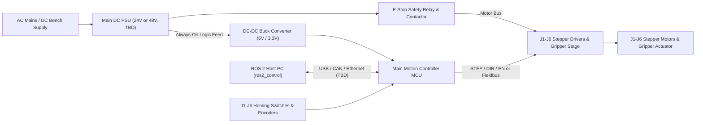

# SML-Arm Electrical Architecture (`electrical/`)

This directory contains the power distribution design, motor driver selection, schematics, PCB layouts, wiring harness tables, and electrical Bill of Materials (BOM) for **SML-Arm**.

---

## Directory Layout

```text
electrical/
├── bom/
│   └── electrical_bom.csv   # Power supplies, motor drivers, MCU, E-Stop, sensors & connectors
├── pcb/                     # PCB layouts, Gerbers & pick-and-place files
├── schematics/              # Native ECAD schematics (e.g., KiCad) and PDF prints
├── wiring/                  # Harness tables, pinout spreadsheets & cable lengths
└── README.md
```

---

## System Power & Signal Architecture



---

## Controller & Driver Pinout Template

Fill in exact MCU GPIO pins, CAN IDs, microstepping DIP settings, and current limits as your hardware revision is finalized:

| Channel | Joint | Driver Model (TBD) | Control Signal (`STEP`/`DIR`/`EN` or Bus ID) | Fault / Alarm Input | Home Sensor Input | Peak Current (A) | Notes |
| :--- | :--- | :--- | :--- | :--- | :--- | :--- | :--- |
| Axis 1 | `dof_joint1` | `TBD` | `TBD` | `TBD` | `TBD` | `TBD` | Base yaw stepper |
| Axis 2 | `dof_joint2` | `TBD` | `TBD` | `TBD` | `TBD` | `TBD` | Shoulder pitch stepper |
| Axis 3 | `dof_joint3` | `TBD` | `TBD` | `TBD` | `TBD` | `TBD` | Elbow pitch stepper |
| Axis 4 | `dof_joint4` | `TBD` | `TBD` | `TBD` | `TBD` | `TBD` | Wrist roll stepper |
| Axis 5 | `dof_joint5` | `TBD` | `TBD` | `TBD` | `TBD` | `TBD` | Wrist pitch stepper |
| Axis 6 | `dof_joint6` | `TBD` | `TBD` | `TBD` | `TBD` | `TBD` | Tool flange stepper |
| Gripper | `gripper_left/right_finger_joint` | `TBD` | `TBD` | `TBD` | `TBD` | `TBD` | Parallel gripper actuator |
| Safety | System E-Stop | `NC Safety Loop` | Interrupt / Hard Bus Cut | `ESTOP_IN` | — | — | Cuts motor bus while keeping MCU telemetry alive |

---

## Pre-Power-On Checklist

Before energizing the main DC motor bus for the first time or after harness rework:

1. **Continuity & Short Check**: Verify resistance across `+V_MOTOR` and `GND` with power disconnected; confirm no dead shorts.
2. **E-Stop Verification**: Press the latching mushroom E-Stop button and verify the motor bus relay opens while MCU 5V/3.3V logic remains measurable (or confirm hardware E-Stop topology matches design).
3. **Voltage Verification**: Power only the logic rail first (`5V` / `3.3V`) and verify regulator outputs before connecting the MCU or motor drivers.
4. **Driver Current Trim**: Confirm current-limit DIP switches, resistors, or UART/CAN registers match motor phase ratings before enabling axes.
5. **Direction & Home Switch Test**: Jog each axis at minimal speed (`5%` scaling) with the arm unloaded and verify homing triggers cleanly stop travel in software before mounting harmonic loads.
